<div align="center">

# SupportDesk AI Pro

### AI-Powered, Multi-Tenant Customer Support Platform

A full-stack helpdesk application with secure ticket management, asynchronous AI ticket triage, and knowledge-base question answering powered by Retrieval-Augmented Generation (RAG).

**Built with React · Node.js · Express · MySQL · Redis · BullMQ · Google Gemini**

[Features](#features) · [Screenshots](#application-walkthrough) · [Architecture](#architecture) · [Setup](#run-locally) · [Testing](#testing)

</div>

---

## 📌 Project Overview

SupportDesk AI Pro is a multi-tenant customer support system designed to help support teams manage tickets and answer customer questions using organization-specific knowledge.

It combines a React frontend and Express REST API with MySQL persistence, Redis-backed background jobs, and Google Gemini for AI-powered ticket classification and RAG-based answers.

### The Problem It Addresses

Support teams need to organize incoming requests, identify urgent issues, protect customer conversations, and find accurate answers from support documentation.

SupportDesk AI Pro brings these workflows into one application and adds AI assistance while maintaining authorization and organization boundaries.

## ✨ Features

### 🔐 Authentication and Authorization

* JWT-based authentication and password hashing.
* Role-based access for supported user roles.
* Protected API routes.
* Organization-aware access checks.

### 🎫 Ticket Management

* Create, list, and view support tickets.
* Track ticket status, category, priority, assignee, and SLA deadline.
* Maintain ticket conversations.
* Support public replies and staff-only internal notes.
* Validate ticket status transitions and staff assignments.
* Restrict customer access to their own tickets.

### 🤖 Asynchronous AI Ticket Triage

* Classify ticket content using Google Gemini.
* Generate category, priority, sentiment, and confidence information.
* Validate structured model output before saving it.
* Queue AI processing using BullMQ and Redis instead of waiting for model processing during ticket creation.
* Retry failed jobs.
* Persist triage suggestions and status in MySQL.

### 📚 Knowledge-Base Management

* Create and update knowledge-base articles.
* Keep new articles in draft status until published.
* Split published content into chunks.
* Generate embeddings for article chunks.
* Store article chunks and embeddings in MySQL.
* Update indexed content when published articles change.

### 🔎 Retrieval-Augmented Generation (RAG)

* Embed user questions using a Gemini embedding model.
* Retrieve semantically relevant chunks from published knowledge-base articles.
* Scope retrieval to the authenticated user's organization.
* Generate answers using retrieved source content.
* Return source metadata with answers.
* Provide a safe fallback when relevant knowledge-base content cannot be retrieved.
* Instruct the language model to acknowledge missing information rather than invent policies or facts.

### 🛡️ Security and Reliability

* Organization-scoped ticket and knowledge-base operations.
* Customer restrictions for ticket ownership and internal notes.
* Request validation using Zod.
* Security middleware and configured CORS.
* Automated backend tests.

> **AI limitation:** AI-generated classifications and answers can be incorrect. Review important decisions and evaluate RAG answers against their source articles before using the system for real customer support.

## 🖥️ Application Walkthrough

The following screenshots show the application's main interfaces and development workflow.

### 1. Login Page

Users sign in with their account to access the application.

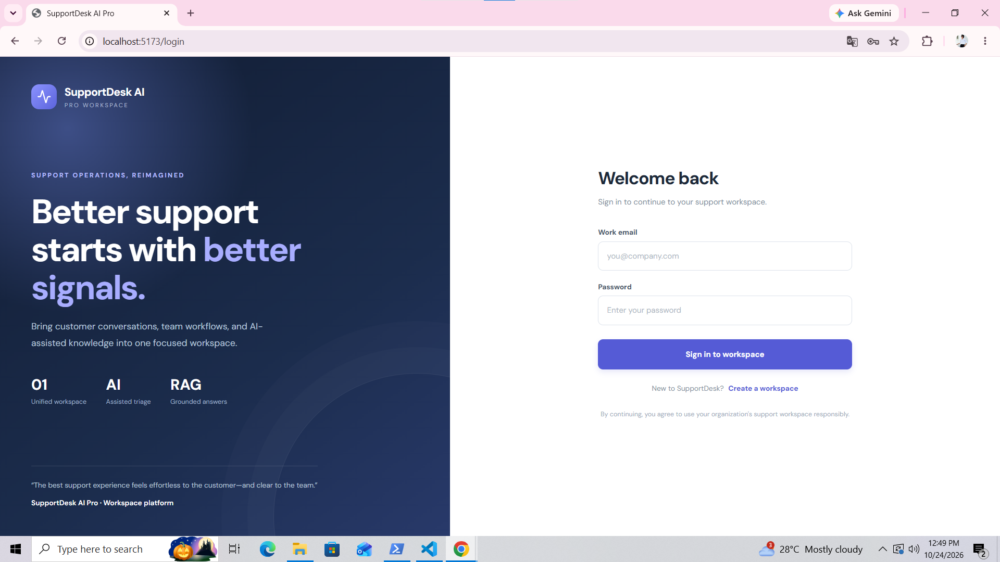

### 2. Dashboard

The dashboard provides an overview of the application and navigation to available sections.

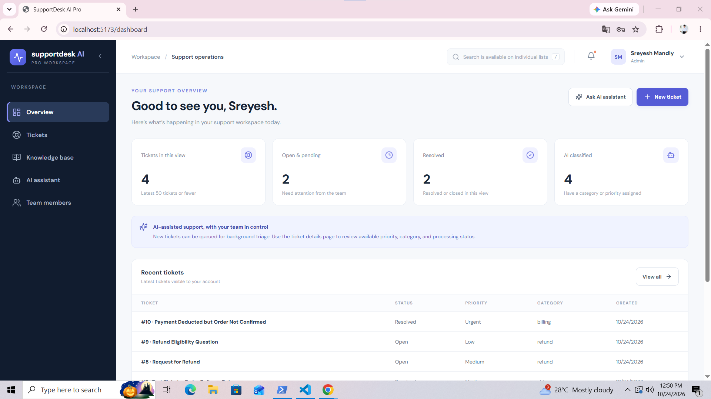

### 3. Ticket List

View the support tickets available to the signed-in user.

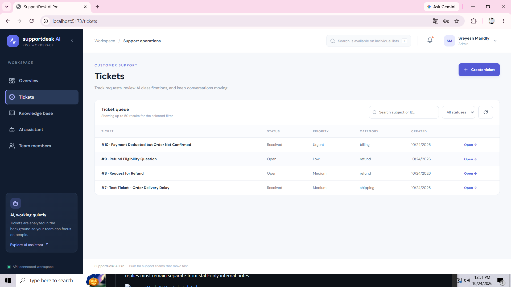

### 4. Create a Ticket

Customers can submit a support request with a subject and description. The backend saves the ticket and attempts to enqueue AI triage.

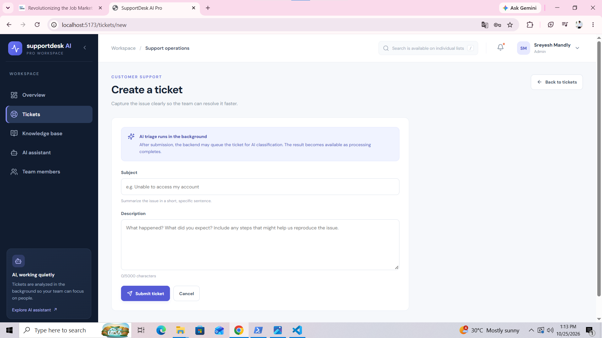

### 5. Ticket Details and Conversation

View ticket information, status, and conversation messages. Customer-facing replies are kept separate from staff-only internal notes.

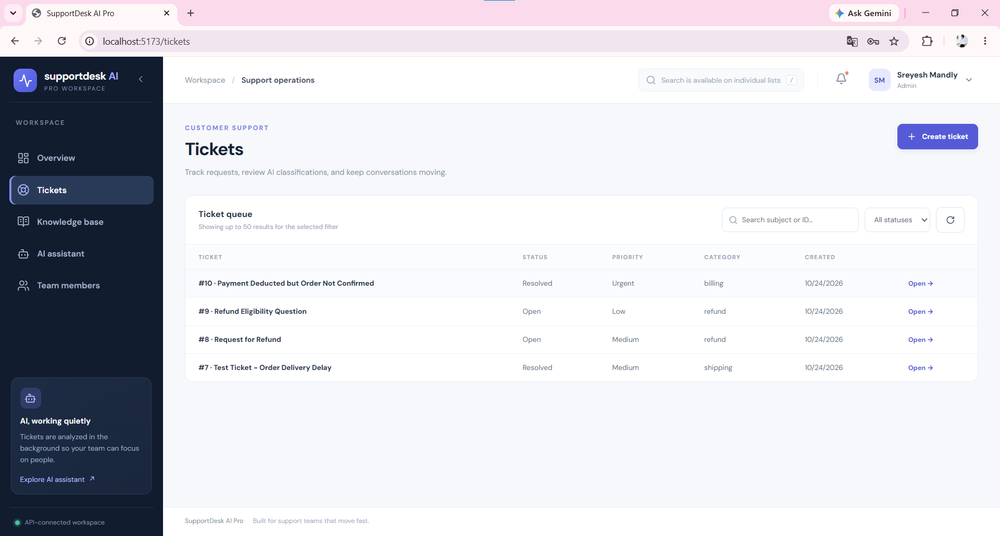

### 6. AI Ticket Triage

The background worker processes queued triage jobs and saves the resulting classification information.

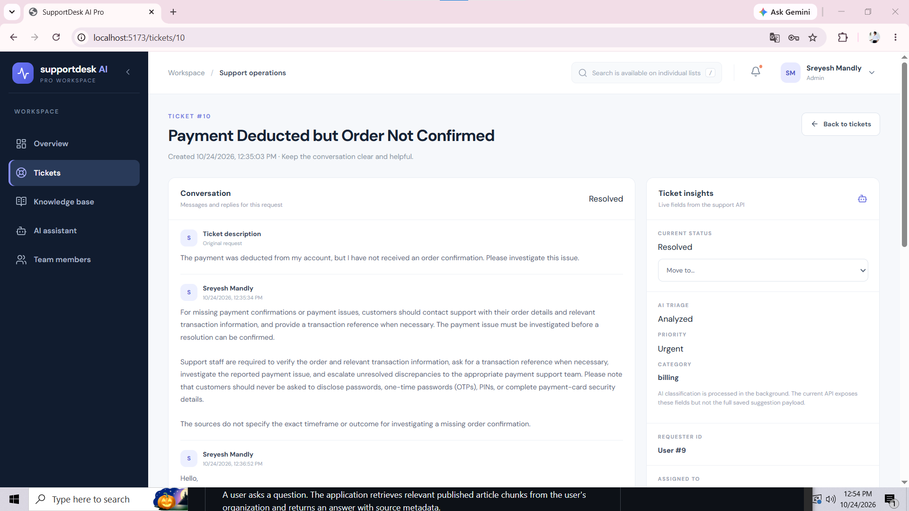

### 7. Knowledge Base

Authorized staff can manage knowledge-base articles and publish content for retrieval.

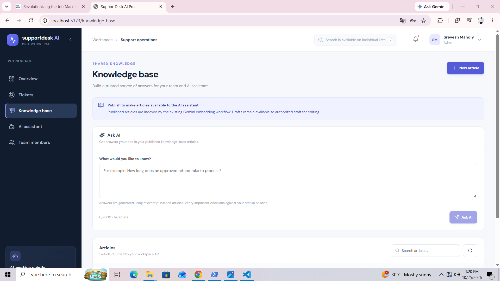

### 8. RAG-Based Answer Generation

The application retrieves relevant published article chunks from the user's organization and generates an answer with source metadata.

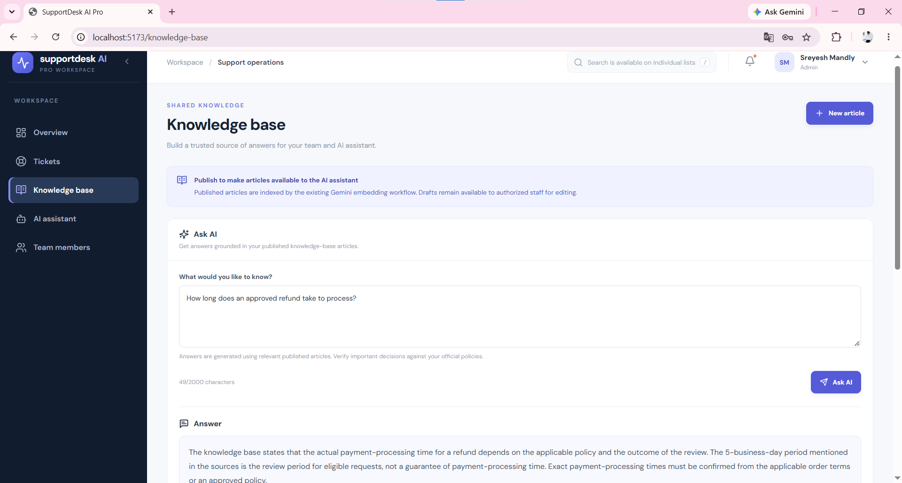

### 9. Automated Test Results

The screenshot documents the backend test results captured during development.

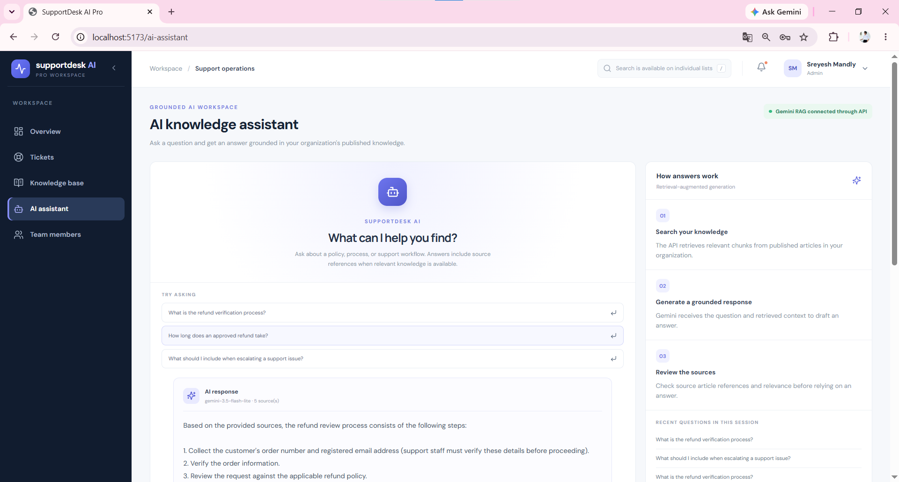

### 10. Team Members

View the team-members interface available in the application.

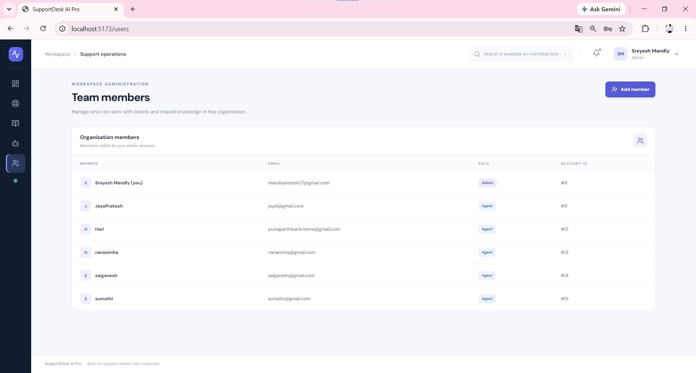

## 🏗️ Architecture

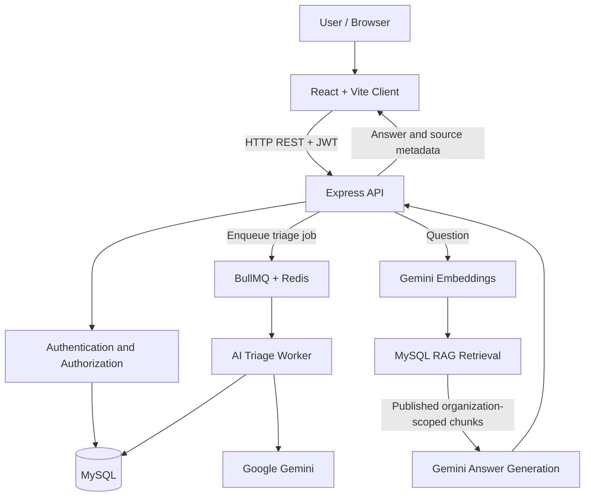

### Ticket Triage Workflow

1. A customer creates a ticket.
2. The API saves the ticket to MySQL and attempts to enqueue a triage job.
3. The background worker processes the queued job.
4. Google Gemini generates structured triage information.
5. The worker validates and persists the result.

### RAG Question-Answering Workflow

1. An authenticated user submits a question.
2. The API derives the organization ID from the authenticated user.
3. The question is converted into an embedding.
4. Retrieval compares the question embedding with stored article-chunk embeddings.
5. Retrieval considers published knowledge-base content belonging to the user's organization.
6. Gemini generates an answer using the retrieved content.
7. The API returns the answer and available source metadata.

## 🧰 Technology Stack

| Area                | Technology                            |
| ------------------- | ------------------------------------- |
| Frontend            | React, JavaScript, Vite               |
| Client routing      | React Router                          |
| HTTP client         | Axios                                 |
| Backend             | Node.js, Express.js                   |
| Validation          | Zod                                   |
| Authentication      | JWT and bcrypt-based password hashing |
| Database            | MySQL                                 |
| Database driver     | mysql2                                |
| Language model      | Google Gemini via `@google/genai`     |
| Embeddings          | Gemini embedding model                |
| Background jobs     | BullMQ                                |
| Queue backend       | Redis                                 |
| Security middleware | Helmet, CORS                          |
| Testing             | Jest, Supertest                       |
| Version control     | Git and GitHub                        |

**Vector storage:** Embeddings are stored in MySQL JSON columns. The current architecture does not require a separate vector database.

## 📂 Project Structure

```text
supportdesk-ai-pro/
├── .github/
│   └── workflows/             # CI configuration
├── client/
│   ├── src/
│   │   ├── pages/              # React pages
│   │   └── services/           # API client and service modules
│   ├── package.json
│   └── vite.config.js
├── database/
│   ├── schema.sql              # Base database schema
│   └── ...                     # Additional migrations, if present
├── docs/
│   └── screenshots/            # README screenshots
├── server/
│   ├── src/
│   │   ├── ai/                 # Triage, embeddings, retrieval, answers
│   │   ├── config/             # Database and application configuration
│   │   ├── middleware/         # Authentication and authorization
│   │   ├── routes/             # REST API routes
│   │   ├── tests/              # Automated tests
│   │   └── workers/            # Background workers
│   ├── scripts/                # Maintenance scripts
│   └── package.json
└── README.md
```

This is a high-level map of the main project areas. Refer to the repository for the complete file list.

## ⚙️ Prerequisites

Install and configure the following before running the application:

* Node.js and npm.
* MySQL Server.
* Redis.
* A Google Gemini API key with access to the configured models.
* Git.

Use versions compatible with the dependencies in the repository.

## 🚀 Run Locally

### 1. Clone the Repository

```powershell
git clone https://github.com/sreyeshmandly/supportdesk-ai.git
Set-Location .\supportdesk-ai
```

If you already have the project locally, navigate to your existing project directory instead.

### 2. Install Dependencies

Install backend dependencies:

```powershell
Set-Location .\server
npm install
```

Install frontend dependencies:

```powershell
Set-Location ..\client
npm install
```

### 3. Configure MySQL

Create the application database and a separate test database, using the database names expected by your local configuration.

Example:

```sql
CREATE DATABASE supportdesk
    CHARACTER SET utf8mb4
    COLLATE utf8mb4_unicode_ci;

CREATE DATABASE supportdesk_test
    CHARACTER SET utf8mb4
    COLLATE utf8mb4_unicode_ci;
```

Apply `database/schema.sql` to the appropriate database. If additional migrations exist, apply them in the documented order.

**Never run automated tests against a production database.**

### 4. Configure Backend Environment Variables

Create `server/.env` and configure the variables required by the backend configuration.

The AI implementation references the following settings:

| Variable                 | Purpose                                           |
| ------------------------ | ------------------------------------------------- |
| `JWT_SECRET`             | Signs and verifies authentication tokens          |
| `GEMINI_API_KEY`         | Authenticates Google Gemini API requests          |
| `GEMINI_MODEL`           | Configures the generation model                   |
| `GEMINI_EMBEDDING_MODEL` | Optional embedding-model override                 |
| `PORT`                   | Optional HTTP port; the server defaults to `4000` |
| `CLIENT_ORIGIN`          | Optional frontend origin for CORS                 |
| `REDIS_HOST`             | Redis hostname                                    |
| `REDIS_PORT`             | Redis port                                        |
| `REDIS_PASSWORD`         | Redis authentication setting                      |

Also configure the MySQL connection variables expected by the database configuration in your checkout.

Check `server/src/config/db.js` and the Redis configuration files for the exact database and connection variable names.

Do not commit `.env` files or expose API keys, passwords, or JWT secrets.

### 5. Start the Backend API

Open a terminal:

```powershell
Set-Location .\server
npm run dev
```

The server defaults to port `4000` unless configured otherwise.

Keep this terminal running.

### 6. Start Redis and the AI Triage Worker

Ensure Redis is running and reachable using the configured connection settings.

Open another terminal:

```powershell
Set-Location .\server
npm run worker
```

Keep this terminal running.

The worker processes asynchronous AI ticket-triage jobs. Ticket creation and successful triage processing are separate operations, so verify the worker logs when testing triage.

### 7. Start the Frontend

Open another terminal:

```powershell
Set-Location .\client
npm run dev
```

Open the local URL printed by Vite, usually:

`http://localhost:5173`

### 8. Verify the Application

1. Sign in with a valid account.
2. Open the dashboard and navigate through the available sections.
3. Create a support ticket.
4. Confirm that the ticket appears in the ticket list.
5. Check whether AI triage is queued and processed by the worker.
6. Open the ticket and test the conversation workflow.
7. As an authorized staff user, create and publish a knowledge-base article.
8. Ask a question that can be answered from the published article.
9. Ask a question that is not covered by the article and evaluate the fallback response.
10. Test that users from another organization cannot access the ticket or knowledge-base content.

These workflows require a correctly configured MySQL database, Redis, valid Gemini access, and suitable test data.

## 🔌 API Overview

The Express application registers the following main route groups:

| Route                 | Purpose                            |
| --------------------- | ---------------------------------- |
| `/api/auth`           | Authentication                     |
| `/api/users`          | User management                    |
| `/api/tickets`        | Ticket and conversation operations |
| `/api/knowledge-base` | Knowledge-base operations and RAG  |

Consult the route implementation for the exact endpoints, request formats, response schemas, and authorization requirements.

### RAG Question-Answering Endpoint

The following is an example request format. Verify the exact route and request schema against the current implementation before using it.

```http
POST /api/knowledge-base/ask
Content-Type: application/json
Authorization: Bearer <token>
```

Example request body:

```json
{
  "question": "What information is required to request a refund?"
}
```

The intended workflow uses the authenticated user's organization to scope knowledge-base retrieval and returns an answer with source metadata when available.

## 🗄️ Database

MySQL stores application records and RAG embeddings.

The project schema includes tables for the main application entities, including organizations, users, tickets, ticket messages, knowledge-base articles, article chunks, and AI suggestions.

* Base schema: `database/schema.sql`
* Additional migrations: inspect the `database/` directory and apply them in the correct order.

Back up important databases before performing schema changes.

## 🧪 Testing

### Backend Automated Tests

From the `server` directory:

```powershell
npm test
```

The backend test script runs Jest with `--runInBand`.

### Frontend Production Build

From the `client` directory:

```powershell
npm run build
```

### Previously Recorded Verification

The development notes supplied for this README record the following results from October 23, 2026:

* **7 backend test suites passed.**
* **72 backend tests passed.**
* **Vite production build passed.**
* **1,665 frontend modules transformed.**

These are historical results, not a claim that the current checkout has been retested. Run the commands above after making changes to verify the current state.

## 🔒 Security Notes

* Keep `.env` files and credentials out of version control.
* Use a strong, unique `JWT_SECRET` in every deployed environment.
* Use least-privilege MySQL credentials.
* Restrict CORS to the expected frontend origin.
* Use HTTPS in production.
* Keep test data separate from real customer data.
* Verify tenant isolation and role permissions before deployment.
* Treat AI outputs as suggestions and review important decisions.
* Avoid including tokens, secrets, or real customer data in screenshots and logs.

## 🚢 Deployment Checklist

Deployment is environment-specific. This README does not claim that the application is currently deployed.

Before deployment, verify:

* [ ] The production frontend API URL is configured.
* [ ] Backend CORS allows only the intended frontend origin.
* [ ] The production MySQL schema and migrations are applied.
* [ ] Redis is available to the background worker.
* [ ] Gemini API access and model names are valid.
* [ ] Secrets are configured through the hosting provider's environment settings.
* [ ] The frontend production build succeeds.
* [ ] Backend automated tests pass.
* [ ] Authentication, tenant isolation, ticket management, and RAG are tested end to end.
* [ ] Database backups and basic monitoring are configured.

## 🗺️ Possible Future Improvements

The following are potential enhancements, not claims that these features are already implemented:

* More comprehensive end-to-end tests.
* Monitoring and operational dashboards for background jobs.
* Ticket analytics and reporting.
* Email notifications.
* Audit logs for sensitive staff actions.
* Expanded RAG retrieval and grounded-answer evaluation.
* Production deployment automation.

## 👨‍💻 Author

**Sreyesh Mandly**

* GitHub: [@sreyeshmandly](https://github.com/sreyeshmandly)
* Project repository: [sreyeshmandly/supportdesk-ai](https://github.com/sreyeshmandly/supportdesk-ai)

## 📄 License

No license is specified in this README. Add a `LICENSE` file and update this section if you intend to grant others permission to reuse or distribute the project.

---

<div align="center">

**SupportDesk AI Pro**

*Secure ticket management, asynchronous AI triage, and knowledge-grounded support.*

</div>
